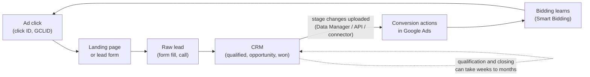

# 1. Product map: Google Ads from a B2B lead-gen advertiser's seat

*Facts here are graded in [sources.md](sources.md). Statements that are my interpretation are marked **(my view)**.*

## Who is on the other side of the product

| Role | What they are judged on | What they need from the product |
|---|---|---|
| **In-house B2B marketer** (mid-size company) | Pipeline sourced from paid search, usually reported to a sales or revenue leader | Spend that turns into qualified conversations, and a way to explain it upward |
| **Agency PPC manager** (several client accounts) | Client retention; proof that spend works | Fast diagnosis across many accounts; defensible reporting |
| **Sales or RevOps partner** (not a Google Ads user) | Qualified pipeline and win rate | Clean, consistent definitions of "qualified" that the ad account can actually use |

The third role matters most and is easiest to forget: the person who knows whether a lead was good usually does not work in the ad platform. Everything about lead quality depends on information moving from that person's system (a CRM) into the ad account.

## The job

**Get qualified sales conversations at an acceptable cost.** Note what is *not* in that sentence: form fills. A form fill is the cheapest thing to measure and the weakest signal of the thing the advertiser cares about.

## The funnel, and where the data lives

The loop only closes when stage changes in the CRM travel back to the ad account **in time, matched to the right click, and under a definition of "qualified" the advertiser trusts**.

## What the product automates, and what the advertiser still owns

| Layer | Google does | The advertiser still owns |
|---|---|---|
| Matching queries to ads | Broad match and "keywordless" matching; with AI Max, search term matching on top of existing Search campaigns (P) | Keyword themes, negatives, brand controls, which campaigns to enable it on |
| Creative | Generates and tailors headlines and descriptions; final URL expansion picks the landing page (P) | Brand and compliance wording; landing page quality; whether to allow final URL expansion |
| Bidding | Smart Bidding predicts the value of each auction from signals (P) | **Which conversion to optimise toward**, and whether that conversion actually means "good lead" |
| Measurement | Offline conversion import and enhanced conversions for leads to attribute later outcomes (P) | Capturing click IDs and hashed user data, defining stages, **uploading outcomes**, keeping the CRM consistent |
| Reporting | Search terms, asset and (for Performance Max) channel reports (P) | Interpreting them, and joining them to CRM outcomes that Google does not see |

**(my view)** Google automates the parts that live inside its own systems. The part that decides whether the automation is pointed at the right target, the definition and delivery of lead quality, is advertiser-side work. That is the structural reason lead quality is a recurring complaint.

## The campaign surfaces a B2B advertiser meets

| Surface | What it is (P) | B2B-relevant note |
|---|---|---|
| **Search campaigns** | Keyword-based ads with Smart Bidding | The traditional workhorse; most control |
| **AI Max for Search** | An optimisation *layer* on existing Search campaigns, not a new campaign type: search term matching, text customisation, final URL expansion | Expands reach beyond your keyword list; adds brand and location controls and more search-term reporting |
| **Performance Max** | One campaign across Search, YouTube, Display, Discover, Gmail, Maps | Reporting expanded in 2025 (channel performance, full search terms, richer assets). Practitioner reports of junk leads centre here (A) |
| **Lead form assets** | A form inside the ad | Faster for the user; the lead lands in Google-hosted form data |
| **Demand Gen** | Discovery-style formats on YouTube and other surfaces | Not analysed further here |

## Constraints that shape every B2B account

1. **Bid toward one stage.** Google's lead-gen guidance says to choose a single funnel stage to bid toward; bidding to several stages in one Target CPA strategy "can be duplicative" (P, PMax lead-gen best practices).
2. **Volume matters.** For value-based bidding Google suggests a goal "closest to a sale or closed deal that has at least 15 conversions in the last 30 days" (P). Deep-funnel B2B events can be far rarer than that **(my view: needs checking per account)**.
3. **Upload windows.** Offline conversions uploaded more than **90 days** after the last click are not imported; for enhanced conversions for leads the limit is **63 days** (P, verified wording). A B2B deal that qualifies or closes after that window **cannot be attributed back to the click**.
4. **Conversion categories carry weight.** Practitioners advise labelling stages correctly (qualified lead, converted lead) because the categories inform how bidding reads them (S).
5. **Learning periods.** Google advises 1 to 2 weeks (up to 6 for complex setups) before major changes (P). That pace sits uneasily with sales cycles measured in months.

## What I take from the map

- The ad platform is good at the *front* of the funnel and has been steadily extending toward the back.
- The back of the funnel is where B2B advertisers live, and it is stitched together by advertiser effort, a time limit, and a definition of quality that Google does not own.
- That makes **verification** (can I see whether the automation is producing qualified leads, and how sure am I?) the interesting product question, more than raw capability.
