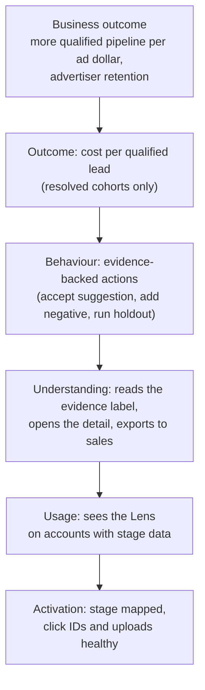

# 6. Metrics and experiment plan

*Companion to the [PRD](05-prd-lead-quality-lens.md). Nothing here has been run. Baselines in the power table are **hypothetical** and only show how the sample-size reasoning works; real baselines would come from the first cohort.*

## Metric tree

Each layer is a precondition for the one above it. A win at the top with no movement below it is suspicious (see "When I would distrust a win").

## Metrics

| Role | Metric | Definition |
|---|---|---|
| **Primary (leading)** | **Evidence-backed action rate** | Share of Lens-active accounts that take at least one action tied to a flagged segment within 14 days of first seeing it |
| **Primary (lagging)** | **Cost per qualified lead, resolved cohorts** | Spend divided by resolved qualified leads, for click cohorts older than the account's maturity point, treatment vs control |
| Supporting | Activation rate | Share of eligible accounts that complete Phase 0 (stage mapped, uploads healthy) |
| Supporting | Evidence-level mix | Share of segments labelled Enough, Thin, Too early (tells us whether the statistics are usable at B2B volumes) |
| Supporting | Time to first action | Days from first flagged segment to first action |
| **Guardrail** | Qualified lead volume per account | Must not fall versus control by more than a margin fixed **before launch** from baseline variance |
| **Guardrail** | Total spend per account | Large drops mean the Lens is driving accounts to over-cut |
| **Guardrail** | Actions taken during a learning period | Measures whether suggestions disturb campaigns |
| **Guardrail** | "This looks wrong" feedback rate, and summary-consistency failures | A rising rate means trust is being damaged |

## Experiment

**Question:** does exposing the Lens (with the Phase 0 activation path) cause advertisers to act on quality evidence, and does that improve cost per qualified lead without reducing qualified volume?

**Design**
- **Unit of randomisation: the account.** Campaigns in one account interact (shared budgets, overlapping queries), so campaign-level randomisation would contaminate the control.
- **Arms:** control (standard interface) versus Lens-enabled. Stratify by spend tier and by stage-data maturity (none, partial, full), and by in-house versus agency, because their behaviour differs.
- **Eligibility:** B2B lead-gen accounts with at least one mapped downstream stage. Accounts without one go through Phase 0 first and are analysed separately as an activation experiment.
- **Analysis:** intention-to-treat, with pre-period covariate adjustment (CUPED) to cut variance. One pre-registered primary metric per question; everything else is exploratory and labelled so.
- **Timing:** leading metrics read at 14 and 30 days. The lagging metric is read only on cohorts that have matured, which is bounded by the **63-day** attribution limit; slower deals are excluded from the primary and reported separately.

**Sample size (hypothetical baselines)**

Two-sided test, alpha 0.05, power 80%, accounts per arm to detect an absolute lift in the evidence-backed action rate:

| Baseline rate | Detect +3 pp | Detect +5 pp | Detect +10 pp |
|---|---|---|---|
| 10% | 1,774 | 686 | 199 |
| 20% | 2,943 | 1,094 | 293 |
| 30% | 3,762 | 1,376 | 356 |

Reading it: if the true baseline is near 20% and I want to detect a 5-point lift, I need about 1,100 accounts per arm. If the eligible pool is smaller than that, I should either accept a larger minimum detectable effect or run longer. **The lagging cost-per-qualified-lead metric will need far more data**, because B2B volumes per account are low and outcomes are slow, so I would treat it as directional in a first test.

## Decision rules (fixed before launch)

| Result | Decision |
|---|---|
| Primary lift at or above the minimum detectable effect, **and** all guardrails hold | Expand |
| Positive lift but the interval includes zero, guardrails hold | Extend the test or increase exposure |
| Action rate up, but cost per qualified lead flat after matured cohorts | Treat as a vanity win; investigate before expanding |
| Any guardrail breached | Pause and diagnose; do not average it away |

## When I would distrust a win

- **Novelty effect:** early curiosity inflates action rate. Check the second and third weeks.
- **Selection:** the Lens only works for accounts with stage data, so a strong result may only describe sophisticated accounts. Report results by data maturity.
- **Agency dominance:** a few agencies managing many accounts could drive the aggregate. Cluster by manager.
- **Right-censoring:** young cohorts look worse. Compare only matured cohorts.
- **Simpson's paradox:** an overall lift that reverses within every spend tier.

## Instrumentation

`lens_viewed`, `segment_flag_shown` (with evidence level), `evidence_label_opened`, `suggestion_accepted`, `suggestion_dismissed`, `holdout_created`, `export_clicked`, `report_wrong_clicked`, `summary_check_failed`, `phase0_step_completed`. Events carry account-level identifiers and aggregate segment ids only; no lead-level data.

## Limits of this plan

- B2B sales cycles mean the outcome I care most about is slow to observe.
- Small and mid-size accounts may never accumulate enough resolved leads to reach a trustworthy interval.
- Random assignment at the account level reduces the usable sample compared with campaign-level designs.

Next: [7. Validation plan and interview guide](07-interview-guide.md)
